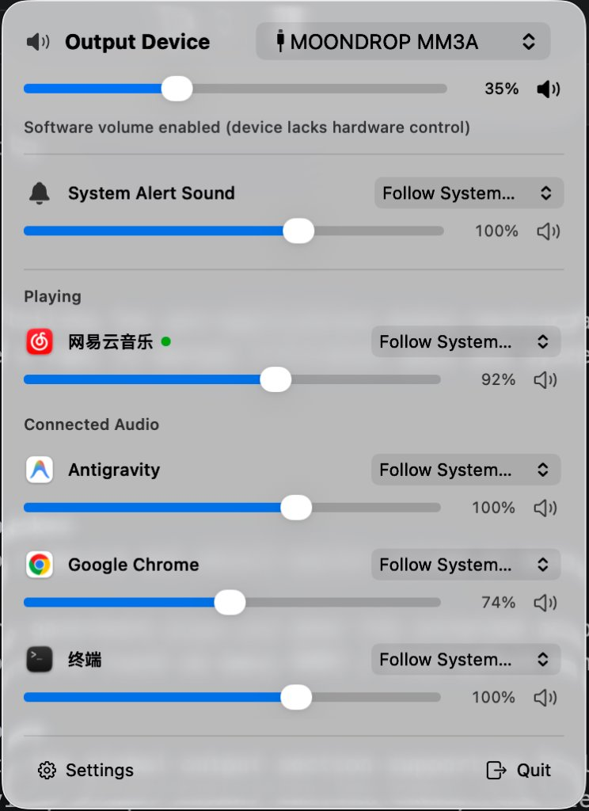

# Ciaccona

English | [简体中文](README_CN.md)

Ciaccona is a lightweight macOS menu bar utility for per-application audio routing and volume control. With minimal CPU and memory usage, it builds on Core Audio Process Taps to manage individual apps and system alert sounds independently.

> The name *Ciaccona* is inspired by the character Ciaccona in *Wuthering Waves*.



## Features

- **Global Output & Software Volume Fallback**
  - Quickly switch the macOS default output device, adjust master volume or mute state, and pick a global EQ preset directly from the quick menu button beside the mute icon.
  - Automatically falls back to a software gain/mute pipeline when the selected output device lacks hardware volume or mute controls (such as many HDMI / DisplayPort monitors).
  - Optionally intercept keyboard volume and mute media keys for devices lacking hardware control (disabled by default; supports `Option + Shift` 1% fine stepping and displays a lightweight floating volume HUD).

- **Independent System Alert Sound Control**
  - Dedicated System Alert control beneath the global output section supporting Follow System Default or a specific output device, independent volume (0%–100%, with optional 0%–200% Boost), mute, and EQ selection.

- **Per-App Volume & Output Device Routing**
  - Detects active and audio-connected apps in real time, grouping helper and renderer subprocesses under their parent app.
  - Per-app output device routing (Follow System Default or a specific device), 0%–100% default volume with an optional Boost mode (0%–200%) and built-in soft limiting, and per-app mute.
  - **Multichannel Audio Support**: Preserves native multichannel formats (>2 channels, such as 5.1 / 7.1 and multichannel interfaces) in both Process Taps and the real-time renderer without adding overhead to 2-channel playback.
  - **Zero-Overhead Passthrough**: Apps left at 100% volume, unmuted, and following the system default create no Process Tap or private aggregate device.
  - **Persistent Rules**: Custom per-app rules are saved automatically and reapplied whenever the app plays audio again, with right-click reset support.

- **Parametric EQ Import & Global / Per-App Selection**
  - Import AutoEQ / EqualizerAPO `.txt` parametric EQ presets (Preamp and `PK`, `LS/LSC`, `HS/HSC`, `LP`, `HP`, `NO`, `BP`, `AP` biquad filters) from the **EQ** section in Settings, and delete presets centrally when no longer needed.
  - Select or turn off imported EQ presets from the global EQ quick-menu button (or by right-clicking the global Output Device section or any app / System Alert row); device EQ is remembered per output device UID and cascades into apps targeting that device, with zero CPU overhead when EQ is inactive.

- **Preferences**
  - **General & Audio Routing**: Launch at Login (`SMAppService`), in-app language selection (Follow System / English / 简体中文), optional display of all system/menu bar audio processes, optional pausing of idle app audio sessions to save overhead, and 4 audio buffer size presets (Ultra Low / Low / Standard / High).
  - **Accessibility**: Optional toggle (off by default) to control software-only output devices with keyboard volume media keys.
  - **EQ**: Centralized management to import and delete `.txt` parametric EQ preset files.
  - Includes a **Restore Default Audio Routing** button that clears all app and system alert routing rules while keeping application preferences intact.

## Requirements & Permissions

- **OS**: macOS 26.0 or later (Apple Silicon `arm64`)
- **Permission**: On first launch, grant **System Audio Recording** permission in **System Settings → Privacy & Security → Screen & System Audio Recording** so Core Audio Process Taps can capture and route per-app audio.
- **Optional Permission**: **Accessibility** permission (**System Settings → Privacy & Security → Accessibility**) is only required if you enable keyboard volume media key takeover in Settings.

## Building & Testing

Open `Ciaccona.xcodeproj` in Xcode, or run the test suite from the command line:

```bash
xcodebuild \
  -project Ciaccona.xcodeproj \
  -scheme Ciaccona \
  -configuration Debug \
  -destination 'platform=macOS,arch=arm64' \
  test
```

Two GitHub Actions workflows are included:

- `.github/workflows/build.yml`: Runs on `push` or `workflow_dispatch`, executes tests, and uploads the built `.dmg` as a workflow artifact.
- `.github/workflows/release.yml`: Manually triggered via `workflow_dispatch`, runs tests, packages the `.dmg`, and publishes a GitHub Release.

## License

[MIT](LICENSE) © 2026 ColdThunder11
