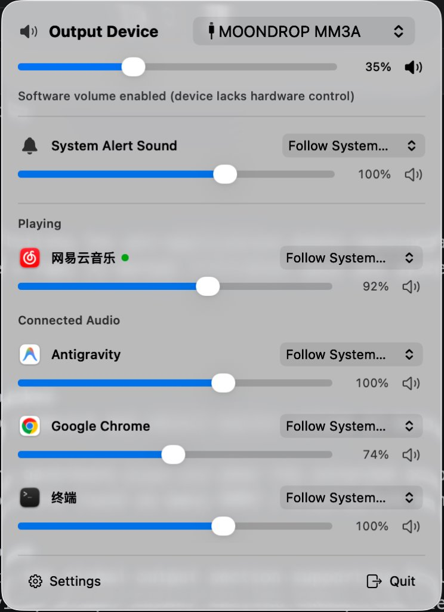

# Ciaccona

[English](README.md) | 简体中文

Ciaccona 是一款轻量级的 macOS 菜单栏分应用音频控制软件，在极低的CPU和内存占用下，基于 Core Audio Process Tap 实现各应用及系统提示音的独立音量调节与输出设备路由。

> Ciaccona的名字源自《鸣潮》中的角色夏空



## 主要功能

- **全局输出与软件音量兜底**
  - 在菜单栏面板顶部快速切换系统默认输出设备，并调节主音量与静音状态。
  - 当所选设备不支持硬件音量或硬件静音（如部分 HDMI / 外接显示器）时，自动通过软件音量管线接管控制。

- **系统提示音独立控制**
  - 在全局输出设备下方单独提供「系统提示音」控制项，支持跟随默认设备或指定输出设备，以及独立音量（0%–150%）与静音开关。

- **分应用音量与输出设备路由**
  - 实时识别正在发声及已连接音频的应用，自动合并主程序与辅助子进程（如浏览器渲染/媒体进程）。
  - 支持为每个应用独立设置输出设备（指定设备或跟随默认设备）、调节音量（最高 150% 软件增益，内置软限幅）以及单独静音。
  - **零开销直通**：当应用保持 100% 音量、未静音且跟随默认设备时，不创建 Tap 与聚合设备，保持原生直通。
  - **规则持久化**：自定义规则自动保存并在应用下次启动发声时自动生效，支持右键重置。

- **设置选项**
  - 支持开机自启动（`SMAppService`）、多语言切换（跟随系统 / English / 简体中文）、显示全部系统与菜单栏进程、静默应用不运行会话开关以及 4 档音频缓冲区大小切换（极低 / 低 / 标准 / 较高）。
  - 提供「还原默认音频路由设置」按钮，可一键清空所有应用与系统提示音的路由规则而不影响软件偏好设置。

## 系统要求与权限

- **系统版本**：macOS 26.0 或更高版本（Apple Silicon `arm64`）
- **必要权限**：首次启动需在「系统设置 → 隐私与安全性 → 录屏与系统录音」中授予 **系统录音** 权限，用于创建 Core Audio Process Tap 控制各应用音频。

## 构建与测试

使用 Xcode 打开 `Ciaccona.xcodeproj` 构建运行，或通过命令行执行测试：

```bash
xcodebuild \
  -project Ciaccona.xcodeproj \
  -scheme Ciaccona \
  -configuration Debug \
  -destination 'platform=macOS,arch=arm64' \
  test
```

仓库同时包含两个 GitHub Actions 工作流：

- `.github/workflows/build.yml`：支持代码提交（`push`）或手动触发，运行测试并将 `.dmg` 构建产物上传至 Action Artifact。
- `.github/workflows/release.yml`：支持手动触发，运行测试、打包 `.dmg` 并发布到 GitHub Release。

## License

[MIT](LICENSE) © 2026 ColdThunder11
