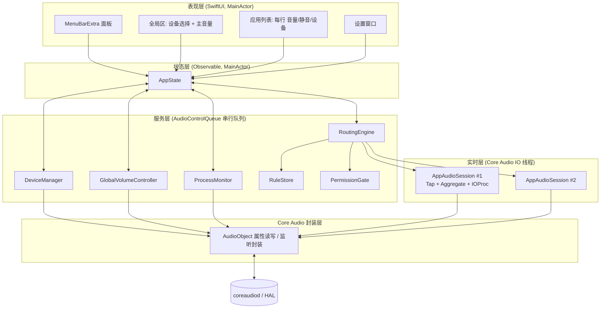
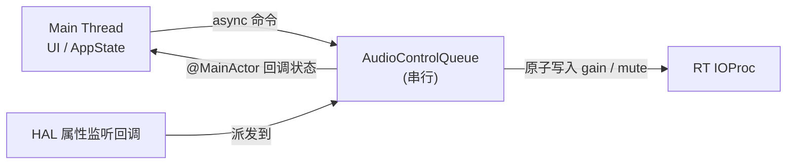
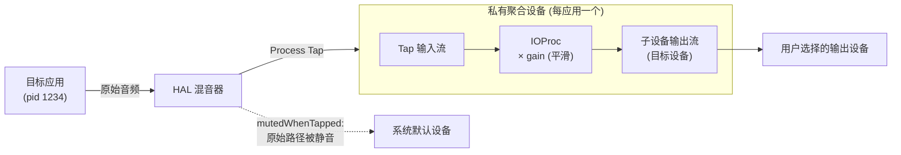
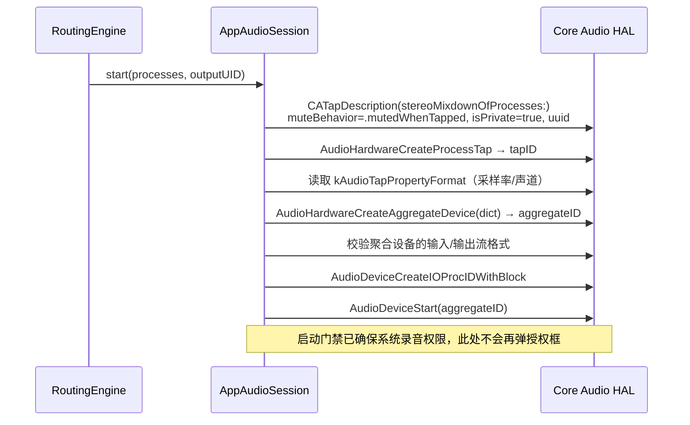
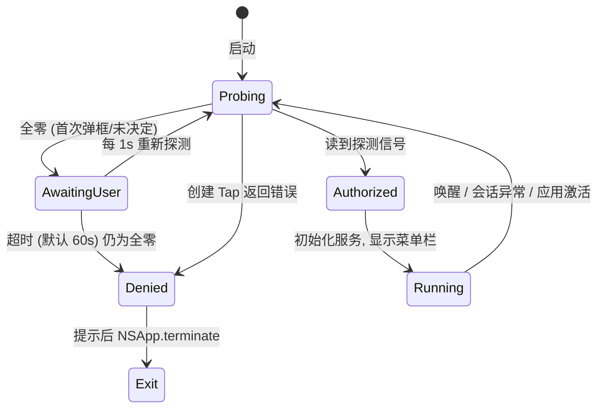

# Ciaccona —— macOS 轻量化音频路由软件 框架设计

> 版本：v0.2（设计稿）  
> 目标平台：**macOS 26 Tahoe 及以上**（Apple Silicon / Intel）  
> 技术栈：Swift 6（严格并发）、SwiftUI、Core Audio（HAL）、AudioToolbox —— **只用系统自带 API，不安装虚拟声卡驱动 / HAL 插件 / 内核扩展**

---

## 1. 目标与范围

### 1.1 功能目标

| 编号 | 功能 | 说明 |
|---|---|---|
| F1 | 全局音量调整 | 调整当前（或任意）输出设备的主音量、静音 |
| F2 | 全局输出设备切换 | 切换系统默认输出设备（可选同时切换"系统提示音"设备） |
| F3 | 分应用音量调整 | 对每个正在发声的应用单独设置 0–150% 音量、静音 |
| F4 | 分应用输出设备 | 把某个应用的声音路由到指定设备（如音乐→耳机、会议→扬声器），或"跟随系统默认" |
| F5 | 规则持久化 | 按 Bundle ID 记住每个应用的设置，应用重启/再次发声时自动恢复 |

### 1.2 非功能目标（"轻量化"的具体含义）

- **零驱动**：不依赖 BlackHole / Soundflower 类虚拟设备，安装即用、卸载即净。
- **按需工作**：应用设置为"100% + 跟随默认设备"时不建立任何音频通路（真正零开销）。
- **资源占用**：空闲 CPU < 0.5%，常驻内存 < 30 MB；每路分应用通路 CPU < 1%。
- **低延迟**：分应用通路额外延迟 ≤ 1 个 IO 周期 + 漂移补偿缓冲（目标 < 20 ms）。
- **形态**：菜单栏常驻应用（`LSUIElement`），无 Dock 图标。

### 1.3 非目标

- 不做 EQ、效果器、录音、多应用混音到虚拟麦克风等功能（可作为后续扩展）。
- 不支持 macOS 26 以下系统（部署目标 `MACOSX_DEPLOYMENT_TARGET = 26.0`，不写任何旧系统兼容分支）。
- 不提供"无权限降级模式"：**系统录音权限是运行前提**，未授权则退出（见第 7 节）。

---

## 2. 关键技术选型

| 需求 | 采用的系统 API | 备注 |
|---|---|---|
| 设备枚举 / 属性 / 变化监听 | `AudioObjectGetPropertyData` / `AudioObjectSetPropertyData` / `AudioObjectAddPropertyListenerBlock` | Core Audio HAL |
| 默认输出设备 | `kAudioHardwarePropertyDefaultOutputDevice`、`kAudioHardwarePropertyDefaultSystemOutputDevice` | 作用于 `kAudioObjectSystemObject` |
| 设备主音量 | `kAudioHardwareServiceDeviceProperty_VirtualMainVolume`（AudioToolbox）| 自动兼容"只有逐声道音量"的设备 |
| 静音 | `kAudioDevicePropertyMute` | |
| 枚举发声进程 | `kAudioHardwarePropertyProcessObjectList`、`kAudioProcessPropertyPID / BundleID / IsRunningOutput` | |
| **捕获单个应用的音频** | `CATapDescription` + `AudioHardwareCreateProcessTap` | 核心能力 |
| 实时线程参数传递 | `Synchronization.Atomic` | 标准库，无需 C 代码 |
| 权限探测 | Process Tap 回环探测（见 7.2）| 仅用公开 API |
| **把捕获的音频送到任意设备** | `AudioHardwareCreateAggregateDevice`（私有聚合设备，包含 Tap + 目标输出设备）| |
| 实时音频处理 | `AudioDeviceCreateIOProcIDWithBlock` + `AudioDeviceStart` | 在 IOProc 中做增益 |
| 应用名 / 图标 | `NSRunningApplication`、`NSWorkspace` | |
| UI | SwiftUI `MenuBarExtra` (`.window` 样式) | |

> [!NOTE]
> **核心思路**：macOS 没有"给某个进程设置音量 / 输出设备"的公开 API。本设计用 **Process Tap（静音原始输出）→ 私有聚合设备 → IOProc 内施加增益 → 写到目标设备** 的方式，等效实现分应用音量与分应用路由。

---

## 3. 总体架构



### 3.1 分层职责

| 层 | 职责 | 线程 |
|---|---|---|
| 表现层 | 菜单栏面板、滑块、设备下拉、设置窗口 | Main |
| 状态层 | 单一数据源 `AppState`，聚合设备 / 进程 / 规则，供 UI 绑定；把用户操作转为服务调用 | Main |
| 服务层 | 业务逻辑；所有可能阻塞的 HAL 调用（创建 Tap、聚合设备等）都在专用串行队列执行 | `AudioControlQueue` |
| 实时层 | 每个被接管的应用一个 `AppAudioSession`，IOProc 内只做无锁、无分配的数值运算 | Core Audio RT 线程 |
| 封装层 | 把 C API 包成类型安全的 Swift 接口，统一错误处理 | 调用者线程 |

### 3.2 线程模型



- **HAL 监听回调**统一用 `AudioObjectAddPropertyListenerBlock(..., AudioControlQueue, ...)` 注册到串行队列，天然避免竞态。
- **UI → 实时线程**的参数（音量、静音）通过原子变量传递，**绝不**在 IOProc 中加锁、分配内存、调用 Swift/ObjC 运行时或打日志。
- 原子变量实现：直接使用标准库 `Synchronization.Atomic<UInt32>`，以 `Float.bitPattern` 存取增益（`Atomic` 不直接支持 `Float`），`.relaxed` 内存序即可。
- Swift 6 严格并发：服务层类型标注为自定义全局 actor `@AudioControlActor`（底层执行器即 `AudioControlQueue`），实时层对象标注 `@unchecked Sendable` 并以文档约束其只含原子量与预分配指针。

---

## 4. Core Audio 封装层（`CoreAudioKit` 模块，自研非系统同名）

### 4.1 通用属性访问

```swift
struct AudioObject {
    let id: AudioObjectID

    func get<T>(_ selector: AudioObjectPropertySelector,
                scope: AudioObjectPropertyScope = kAudioObjectPropertyScopeGlobal,
                element: AudioObjectPropertyElement = kAudioObjectPropertyElementMain) throws -> T
    func getArray<T>(_ selector: AudioObjectPropertySelector, scope: ...) throws -> [T]
    func getString(_ selector: AudioObjectPropertySelector) throws -> String   // CFString
    func set<T>(_ selector: AudioObjectPropertySelector, value: T, scope: ...) throws
    func isSettable(_ selector: AudioObjectPropertySelector, scope: ...) -> Bool
    func has(_ selector: AudioObjectPropertySelector, scope: ...) -> Bool

    /// 返回 token，释放即注销监听
    func observe(_ selector: AudioObjectPropertySelector, scope: ...,
                 queue: DispatchQueue, handler: @escaping () -> Void) -> ListenerToken

    static let system = AudioObject(id: AudioObjectID(kAudioObjectSystemObject))
}

struct CoreAudioError: Error { let status: OSStatus; let context: String }
```

### 4.2 领域对象

```swift
struct AudioDevice: Identifiable, Hashable {
    let id: AudioObjectID
    let uid: String              // 持久化用：kAudioDevicePropertyDeviceUID（跨重启稳定）
    let name: String
    let transport: UInt32        // 内建 / USB / 蓝牙 / HDMI / AirPlay / Aggregate …
    let hasOutput: Bool          // kAudioDevicePropertyStreamConfiguration (output scope) 声道数 > 0
    let canSetVolume: Bool
    let canMute: Bool
}

struct AudioProcess: Identifiable, Hashable {
    let id: AudioObjectID        // Core Audio 进程对象 ID
    let pid: pid_t
    let bundleID: String?
    var isRunningOutput: Bool    // 是否正在发声
}
```

> [!IMPORTANT]
> 枚举设备时需**过滤掉本软件自己创建的私有聚合设备**（按 UID 前缀 `com.coldthunder11.ciaccona.agg.` 识别），避免出现在 UI 和自身路由中。

---

## 5. 全局音量与输出设备（F1 / F2）

### 5.1 DeviceManager

职责：维护输出设备列表与默认设备。

| 操作 | 实现 |
|---|---|
| 枚举设备 | `system.getArray(kAudioHardwarePropertyDevices)` → 过滤 `hasOutput` 且非本软件私有聚合设备 |
| 读默认输出 | `system.get(kAudioHardwarePropertyDefaultOutputDevice)` |
| 设默认输出 | `system.set(kAudioHardwarePropertyDefaultOutputDevice, value: deviceID)` |
| 系统提示音设备（可选联动） | `kAudioHardwarePropertyDefaultSystemOutputDevice` |
| 监听 | `kAudioHardwarePropertyDevices`（插拔）、`kAudioHardwarePropertyDefaultOutputDevice`（他处修改）、`kAudioHardwarePropertyServiceRestarted`（coreaudiod 重启） |

### 5.2 GlobalVolumeController

```swift
final class GlobalVolumeController {
    func volume(of device: AudioDevice) throws -> Float          // 0.0 ... 1.0
    func setVolume(_ v: Float, of device: AudioDevice) throws
    func isMuted(_ device: AudioDevice) throws -> Bool
    func setMuted(_ m: Bool, of device: AudioDevice) throws
    func observe(device: AudioDevice, onChange: @escaping (Float, Bool) -> Void) -> [ListenerToken]
}
```

- 音量读写使用 `kAudioHardwareServiceDeviceProperty_VirtualMainVolume`（scope = `kAudioDevicePropertyScopeOutput`），它会自动把主音量映射到设备的各声道，并保持左右平衡（`...VirtualMainBalance`）。
- 写前用 `isSettable` 判断；**不支持硬件音量的设备（HDMI、部分 USB DAC）**UI 中置灰并提示"该设备音量由外部控制"。
  - 可选增强：对这类设备启用"软件主音量"——用全局 Tap（`CATapDescription(stereoGlobalTapButExcludeProcesses: [])`）接管所有声音再施加增益。默认关闭，因为它让所有音频都经过本软件。
- 默认设备切换后，重新绑定音量监听到新设备。
- 滑块拖动做 **节流（~30 Hz）**，避免频繁 HAL 调用。

---

## 6. 分应用音量与输出设备（F3 / F4）—— 核心设计

### 6.1 原理



1. 为目标应用的所有音频进程对象创建 **Process Tap**，`muteBehavior = .mutedWhenTapped`：Tap 存在且被读取时，原始输出被静音，避免"双声"。
2. 创建一个 **私有聚合设备**，包含：
   - 子设备：用户为该应用选择的输出设备（主时钟设备）；
   - Tap 列表：上一步的 Tap（开启漂移补偿）。
3. 在聚合设备上注册 IOProc：`inInputData` 即应用的音频，`outOutputData` 即目标设备的输出缓冲；中间乘以增益。
4. 结果：应用音量 = 用户设定增益，输出设备 = 用户指定设备；最终响度 = 应用增益 × 目标设备硬件音量。

### 6.2 ProcessMonitor：发现"应用"

Core Audio 报告的是**进程**，用户关心的是**应用**。很多应用通过辅助进程发声（Chrome Helper、Electron Renderer、WebKit 进程等），需要归并。

```swift
struct AudioApp: Identifiable {
    let id: String                  // 归并键：主应用 bundleID（无则 "pid:<pid>"）
    let displayName: String
    let icon: NSImage?
    var processes: [AudioProcess]   // 属于该应用的全部 Core Audio 进程对象
    var isPlaying: Bool             // 任一进程 isRunningOutput
}
```

**归并策略（按优先级）：**

1. `NSRunningApplication(processIdentifier:)` 能直接得到常规应用（`activationPolicy == .regular`）→ 自身即主应用。
2. 沿父进程链向上查找（`sysctl(KERN_PROC_PID)` 获取 `ppid`，公开 API），直到找到 `.regular` 应用。
3. Bundle ID 前缀匹配：`com.google.Chrome.helper` → `com.google.Chrome`。
4. 都失败：作为独立条目显示（用进程名）。

**监听：**

- `kAudioHardwarePropertyProcessObjectList`：进程出现/消失。
- 每个进程的 `kAudioProcessPropertyIsRunningOutput`：发声状态（用于 UI 排序与按需启停）。
- `NSWorkspace.didLaunchApplicationNotification / didTerminateApplicationNotification`：辅助刷新名称、图标。

> [!WARNING]
> Safari 等 WebKit 应用的音频可能由**系统共享的** `com.apple.WebKit.GPU` 进程输出，归并时无法精确区分多个 WebKit 宿主应用。v1 将其作为独立条目"Safari / WebKit"显示，并在文档的已知限制中说明。

### 6.3 RoutingEngine：决策何时建立通路

```swift
struct AppRule: Codable, Equatable {
    var volume: Float = 1.0          // 0.0 ... 1.5
    var muted: Bool = false
    var output: OutputTarget = .followSystemDefault
}

enum OutputTarget: Codable, Equatable {
    case followSystemDefault
    case device(uid: String, lastKnownName: String)
}
```

决策表：

| 规则状态 | 动作 |
|---|---|
| `volume == 1.0 && !muted && output == .followSystemDefault` | **不建通路**（直通，零开销）；若已有则销毁 |
| `muted == true` 且无路由需求 | 仅创建 Tap（`mutedWhenTapped`）+ 不输出，或 gain = 0（实现更简单，推荐后者以复用同一路径） |
| 其他 | 创建 / 更新 `AppAudioSession` |

事件处理：

| 事件 | 处理 |
|---|---|
| 用户改音量 / 静音 | 若已有 session：仅原子更新 gain（无 HAL 调用，即时生效）；否则按决策表创建 |
| 用户改输出设备 | 重建聚合设备（Tap 可复用）|
| 系统默认设备变化 | 所有 `.followSystemDefault` 且有 session 的应用重建聚合设备 |
| 目标设备被拔出 | 回退到系统默认设备并在 UI 标记"设备离线"；设备重新出现时自动恢复（按 UID 匹配）|
| 应用新增辅助进程 | 通过设置 `kAudioTapPropertyDescription` 更新 Tap 的进程列表（无需重建）|
| 应用退出 | 销毁 session；规则保留在 RuleStore |
| `kAudioHardwarePropertyServiceRestarted` | 全部 session 失效，丢弃对象 ID 后整体重建 |

**按需启停（省电）**：应用 `isRunningOutput == false` 持续 N 秒（默认 5 s）后 `AudioDeviceStop`，再次发声时 `AudioDeviceStart`。注意：Tap 停止读取时原始声音会恢复，因此启动必须在检测到发声后立即进行；也可选择保持运行以换取零漏音（设置项）。

### 6.4 AppAudioSession：单应用音频通路

```swift
final class AppAudioSession {
    let appID: String
    private(set) var tapID: AudioObjectID = kAudioObjectUnknown
    private(set) var aggregateID: AudioObjectID = kAudioObjectUnknown
    private var ioProcID: AudioDeviceIOProcID?
    private let tapUUID = UUID()
    private let params: RTParams             // 原子: targetGain, muted

    func start(processes: [AudioObjectID], outputDeviceUID: String) throws
    func updateProcesses(_ processes: [AudioObjectID]) throws   // 更新 Tap 描述
    func switchOutput(to deviceUID: String) throws              // 重建聚合设备
    func setGain(_ g: Float)                                    // 仅原子写
    func stop()                                                 // 逆序销毁
}
```

**创建流程：**



**聚合设备描述字典：**

```swift
let desc: [String: Any] = [
    kAudioAggregateDeviceNameKey:          "Ciaccona-\(appID)",
    kAudioAggregateDeviceUIDKey:           "com.coldthunder11.ciaccona.agg.\(UUID().uuidString)",
    kAudioAggregateDeviceIsPrivateKey:     true,     // 不出现在系统设备列表，进程退出自动回收
    kAudioAggregateDeviceIsStackedKey:     false,
    kAudioAggregateDeviceMainSubDeviceKey: outputDeviceUID,   // 以输出设备为主时钟
    kAudioAggregateDeviceSubDeviceListKey: [
        [kAudioSubDeviceUIDKey: outputDeviceUID]
    ],
    kAudioAggregateDeviceTapListKey: [
        [kAudioSubTapUIDKey: tapUUID.uuidString,
         kAudioSubTapDriftCompensationKey: true]      // Tap 与输出设备时钟不同步时做补偿
    ],
    kAudioAggregateDeviceTapAutoStartKey: true,
]
```

**销毁顺序**（必须严格逆序，防止泄漏与爆音）：
`AudioDeviceStop` → `AudioDeviceDestroyIOProcID` → `AudioHardwareDestroyAggregateDevice` → `AudioHardwareDestroyProcessTap`。

### 6.5 实时 IOProc 设计

```swift
// 伪代码：运行在 Core Audio 实时线程
{ inNow, inInputData, inInputTime, outOutputData, inOutputTime in
    let target = params.muted.load() ? 0 : params.targetGain.load()
    // 每个缓冲区内线性插值，从 currentGain 平滑到 target，消除"拉链噪声"
    let step = (target - state.currentGain) / Float(frameCount)

    // 输入：Tap 流（立体声 Float32）；输出：目标设备流（N 声道 Float32）
    // 声道映射：L→ch0, R→ch1；目标设备多于 2 声道时其余声道清零；
    //           单声道设备时 (L+R)/2
    // 使用 vDSP_vrampmul 等 Accelerate 函数完成带斜坡的乘法
    // gain > 1.0 时追加软限幅（tanh 近似或简单 hard clip），防止削波
}
```

实时线程规则：

- ❌ 不分配内存、不加锁、不访问 Swift 类属性的引用计数路径、不调用 `print`/`os_log`。
- ✅ 状态（`currentGain`、声道映射表）在 `start()` 时预先分配为 `UnsafeMutablePointer`。
- ✅ 输入缓冲为空（如应用暂停）时向输出写 0。

### 6.6 格式与时钟

- Tap 使用 `stereoMixdownOfProcesses`，统一为立体声 Float32，简化 IOProc；多声道直通（5.1/7.1）列入后续版本（`CATapDescription(processes:...)` 非混缩模式）。
- 聚合设备以**目标输出设备为主时钟**，Tap 开启漂移补偿，由 HAL 负责重采样/对齐。
- `start()` 中校验 IOProc 的输入/输出 `AudioStreamBasicDescription`：若采样率不一致且 HAL 未自动处理，回退到"`AudioConverter` + 无锁环形缓冲"路径（预留接口，v1 仅记录日志并提示）。
- 监听目标设备的 `kAudioDevicePropertyNominalSampleRate`，变化时重建聚合设备。

### 6.7 多应用指向同一设备：方案权衡

| 方案 | 优点 | 缺点 |
|---|---|---|
| **A. 每应用一个聚合设备（采用）** | 隔离好：改一个应用不影响其他应用；逻辑简单 | 多个 IOProc，多应用同时接管时开销略高 |
| B. 每输出设备一个聚合设备、挂多个 Tap | IOProc 数量少 | 增删应用需重建聚合设备，会让同设备上其他应用短暂断音 |

v1 采用方案 A；若实测在 10+ 应用接管时开销明显，再评估方案 B。

---

## 7. 权限与分发

### 7.1 权限策略：系统录音是硬性前提

> [!IMPORTANT]
> Ciaccona **每次启动都先检查"系统录音"权限**：已授权才进入主界面；未授权就请求；用户拒绝（或超时未授权）则提示后**退出程序**。不提供"只用全局功能"的降级模式。

| 项 | 设计 |
|---|---|
| Info.plist | `NSAudioCaptureUsageDescription`："Ciaccona 需要“系统录音”权限来单独调整各应用的音量和输出设备。没有此权限无法运行。" |
| 触发方式 | 创建 Process Tap 时由系统弹出授权框（隐私与安全性 → 录屏与系统录音 → 仅系统录音） |
| 启动门禁 | `PermissionGate` 在 `applicationDidFinishLaunching` 中最先执行，通过前**不创建菜单栏图标、不初始化任何服务** |
| 拒绝 / 超时 | 弹出模态提示："未获得系统录音权限，Ciaccona 将退出。" 按钮：「打开系统设置」（打开对应隐私面板后退出）/「退出」→ `NSApp.terminate(nil)` |
| 运行中被撤销 | 系统设置中撤销权限后，在关键时机重新探测（见 7.3），确认失去权限则同样提示后退出 |

### 7.2 授权状态探测（只用公开 API）

macOS 没有公开的"系统录音"权限预检 API；未授权时创建 Tap 往往**不会报错，只是读到全零数据**。因此用"**自回环探测**"来判断：

1. 用 `kAudioHardwarePropertyTranslatePIDToProcessObject` 拿到**本进程**的 Core Audio 进程对象。
2. 对本进程建 Tap（`mutedWhenTapped`，因此用户听不到探测音）+ 私有聚合设备 + IOProc。
3. 本进程用 `AVAudioSourceNode` 向默认设备播放一段固定的低电平探测信号（如 -40 dBFS、1 kHz、200 ms）。
4. IOProc 中统计输入 RMS：**读到非零信号 ⇒ 已授权**；在等待窗口内一直为全零 ⇒ 未授权或用户还没决定。
5. 探测结束后按逆序销毁所有探测资源。



- **AwaitingUser** 阶段显示一个小窗："请在系统弹框中允许系统录音……"，附「打开系统设置」按钮与倒计时。
- 若用户之前已拒绝，系统不会再弹框，探测会直接全零直至超时 → 退出；提示文案中说明需在系统设置中手动打开权限后重新启动 Ciaccona（在系统设置中授权后，macOS 也会提示"退出并重新打开"）。

### 7.3 运行期复检

| 时机 | 动作 |
|---|---|
| `NSWorkspace.didWakeNotification` | 重新探测 |
| 某 session 的目标应用 `isRunningOutput == true`，但 IOProc 连续 3 s 读到全零 | 触发一次探测，区分"应用本身静音"与"权限被撤销" |
| `AudioHardwareCreateProcessTap` 返回错误 | 立即探测 |

确认失去权限 → 先销毁所有 session（让各应用声音恢复原路径）→ 提示 → 退出。

### 7.4 签名与分发

| 项 | 设计 |
|---|---|
| 签名分发 | Developer ID + Hardened Runtime + 公证（Notarization）；v1 不启用 App Sandbox（沙盒下 Tap / 聚合设备兼容性需单独验证），不上架 Mac App Store |
| 开机启动 | `SMAppService.mainApp.register()` |

---

## 8. 持久化（RuleStore）

- 存储位置：`~/Library/Application Support/Ciaccona/rules.json`（规则）+ `UserDefaults`（偏好）。
- 键：应用归并键（Bundle ID）；设备以 **UID** 存储（`AudioObjectID` 每次启动会变）。

```json
{
  "version": 1,
  "rules": {
    "com.spotify.client": { "volume": 0.6, "muted": false,
                            "output": { "device": { "uid": "BuiltInSpeakerDevice", "lastKnownName": "MacBook Pro 扬声器" } } },
    "us.zoom.xos":        { "volume": 1.2, "muted": false, "output": "followSystemDefault" }
  },
  "preferences": { "linkSystemAlertDevice": true, "keepSessionsRunning": false }
}
```

- 写入：防抖 1 s 后原子写（`Data.write(options: .atomic)`）。
- 规则为默认值时自动删除条目，保持文件精简。

---

## 9. UI 设计（MenuBarExtra）

```
┌──────────────────────────────────────┐
│ 🔊 输出设备  [ MacBook Pro 扬声器  ▾ ] │  ← F2
│ ────────────●──────────  72%   🔇     │  ← F1
├──────────────────────────────────────┤
│ 正在播放                              │
│ 🎵 Spotify   ──●─────── 60%  🔇 [耳机▾]│  ← F3/F4
│ 🌐 Chrome    ─────●──── 100% 🔇 [默认▾]│
│ 📹 Zoom      ───────●── 120% 🔇 [默认▾]│
├──────────────────────────────────────┤
│ 最近（未发声，规则已保存）            │
│ 💬 Slack     ...                      │
├──────────────────────────────────────┤
│ ⚙︎ 设置                        退出   │
└──────────────────────────────────────┘
```

- 菜单栏图标随全局音量/静音变化。
- 设备下拉中：第一项"跟随系统默认（当前：xxx）"，离线设备灰显保留。
- 应用行右键：重置为默认、从列表移除。
- 可选：全局快捷键调节前台应用音量（`NSEvent.addGlobalMonitorForEvents` 需辅助功能权限，列为后续版本）。

---

## 10. 工程结构

```
Ciaccona/
├── Ciaccona.xcodeproj
├── App/
│   ├── CiacconaApp.swift            // @main, MenuBarExtra, 生命周期
│   ├── AppState.swift               // @Observable 单一数据源
│   └── Info.plist / Ciaccona.entitlements
├── UI/
│   ├── MenuPanelView.swift
│   ├── GlobalOutputSection.swift
│   ├── AppRowView.swift
│   ├── DevicePicker.swift
│   ├── PermissionWaitView.swift     // 等待授权小窗（倒计时 + 打开系统设置）
│   └── SettingsView.swift
├── Services/
│   ├── DeviceManager.swift
│   ├── GlobalVolumeController.swift
│   ├── ProcessMonitor.swift
│   ├── AppGrouping.swift            // 进程 → 应用 归并
│   ├── RoutingEngine.swift
│   ├── RuleStore.swift
│   └── PermissionGate.swift         // 启动门禁 + 自回环探测 + 运行期复检
├── Audio/
│   ├── AppAudioSession.swift
│   ├── AggregateDeviceBuilder.swift
│   ├── TapBuilder.swift
│   └── RTRenderer.swift             // IOProc 内的数值处理（Accelerate）
├── CoreAudioWrapper/
│   ├── AudioObject.swift
│   ├── AudioObject+Listener.swift
│   ├── AudioDevice.swift
│   ├── AudioProcess.swift
│   └── CoreAudioError.swift
└── Tests/
    ├── AppGroupingTests.swift
    ├── RoutingDecisionTests.swift   // 决策表纯逻辑测试
    ├── RuleStoreTests.swift
    └── RTRendererTests.swift        // 增益斜坡、声道映射、限幅
```

依赖：**仅系统框架**（SwiftUI、AppKit、CoreAudio、AudioToolbox、AVFAudio（仅权限探测信号）、Accelerate、Synchronization、ServiceManagement），无第三方包，无 C/ObjC 代码。

---

## 11. 错误处理与健壮性

| 场景 | 策略 |
|---|---|
| HAL 调用返回非 `noErr` | 统一抛 `CoreAudioError(status, context)`；`status` 以四字符码记录到 `os.Logger` |
| 创建 session 失败 | 回滚已创建的资源；规则保留；UI 行显示⚠︎并可重试；**原始声音不受影响**（Tap 未建立即不静音） |
| 本软件崩溃 | 私有聚合设备与 Tap 随进程退出被系统回收，应用声音自动恢复原路径（无残留，这是不用虚拟驱动的重要优势） |
| coreaudiod 重启 | 监听 `kAudioHardwarePropertyServiceRestarted`，清空所有 ID 缓存后全量重建 |
| 睡眠 / 唤醒 | `NSWorkspace.didWakeNotification` 后先复检权限（7.3），再校验所有 session，失效则重建 |
| 权限被撤销 | 销毁全部 session → 提示 → 退出 |
| 蓝牙设备切换卡顿 | 设备切换操作异步执行，UI 先乐观更新，失败回滚 |

---

## 12. 性能预算与测试

### 12.1 指标

| 指标 | 目标 | 测量方法 |
|---|---|---|
| 空闲 CPU | < 0.5% | Instruments – Time Profiler |
| 单路 session CPU | < 1% | 同上 |
| 内存 | < 30 MB | Activity Monitor / Allocations |
| 额外延迟 | < 20 ms | 回环测试（输出 → 麦克风脉冲相关） |
| RT 线程违规 | 0 | Instruments – Audio System Trace，观察 overload |

### 12.2 测试矩阵

- 设备：内建扬声器、有线耳机、USB DAC、AirPods（蓝牙）、HDMI 显示器、AirPlay。
- 应用：Music、Spotify、Chrome/Safari 视频、Zoom/Teams、游戏、系统提示音。
- 场景：发声中切换设备、拔插设备、睡眠唤醒、快速拖动滑块、10 个应用同时接管、采样率 44.1/48/96 kHz 混用。

---

## 13. 已知限制

1. 仅支持 macOS 26 及以上。
2. 必须授予"系统录音"权限，否则程序退出；权限探测依赖"自回环"方法（系统无公开预检 API），首次授权最多等待 60 s。
3. WebKit 共享 GPU 进程等场景下，进程→应用归并可能不精确。
4. 接管后的应用会增加少量延迟，对音画同步极敏感的场景（专业音频）不建议接管。
5. v1 分应用通路统一为立体声，多声道内容会被混缩。
6. 使用独占模式（Hog Mode）的专业音频软件无法被接管。

---

## 14. 里程碑

| 阶段 | 内容 | 产出 |
|---|---|---|
| M0 | Core Audio 封装层 + 设备枚举/监听 + **PermissionGate（启动门禁、自回环探测、拒绝即退出）** | 命令行 Demo 打印设备与进程；权限流程跑通 |
| M1 | 全局音量 / 默认设备（F1/F2）+ 菜单栏 UI | 可用的全局控制器 |
| M2 | 单应用 Tap + 聚合设备 + 增益（F3 原型） | 验证技术链路 |
| M3 | 分应用输出设备（F4）、进程归并、RoutingEngine 决策 | 功能完整 |
| M4 | RuleStore 持久化（F5）、异常恢复、按需启停 | 稳定版 |
| M5 | 性能调优、测试矩阵、签名公证 | v1.0 发布 |
| 后续 | 多声道直通、快捷键、EQ、配置档案（场景一键切换）| — |
